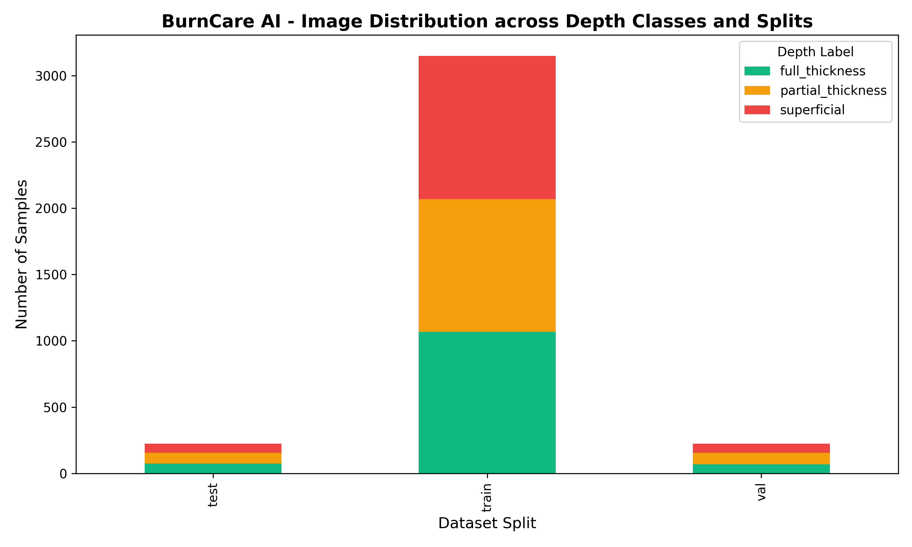

# BurnCare AI - Dataset Distribution Report

## Summary
- **Total Dataset Size (with Augmentation)**: 3600 samples
- **Original Real Images**: 1500
- **Augmented Training Images**: 2100
- **Patient Isolation**: 100% Guaranteed (No patient overlap across Train/Val/Test)

## Class Breakdown
```
depth_label  full_thickness  partial_thickness  superficial
split                                                      
test                     75                 79           71
train                  1068               1002         1080
val                      69                 87           69
```

## Triage Breakdown
```
triage_label  emergency  primary
split                           
test                123      102
train              1668     1482
val                 121      104
```


